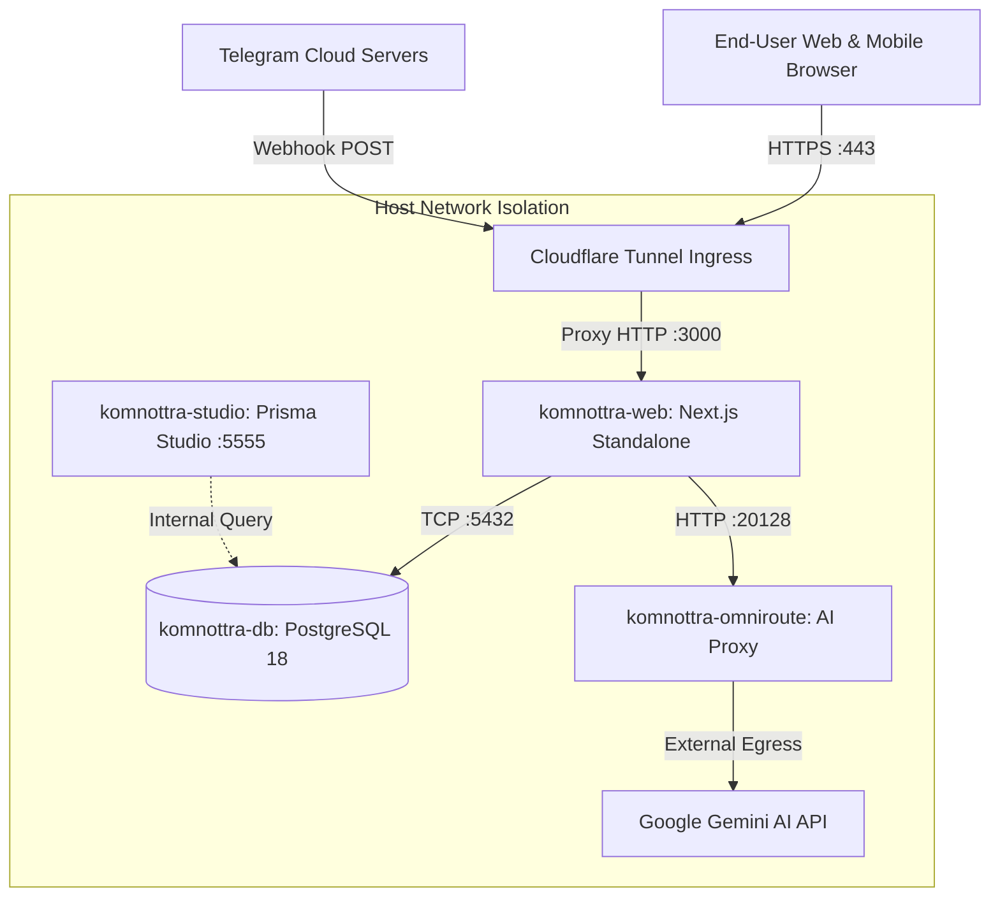
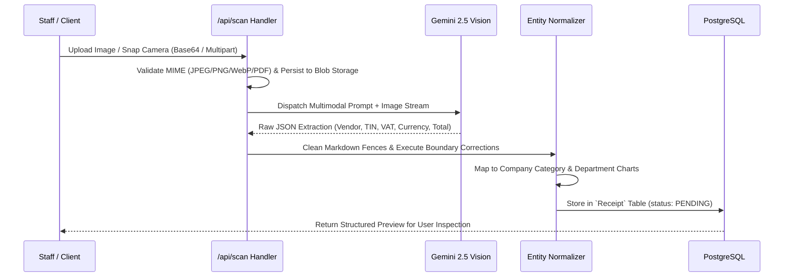
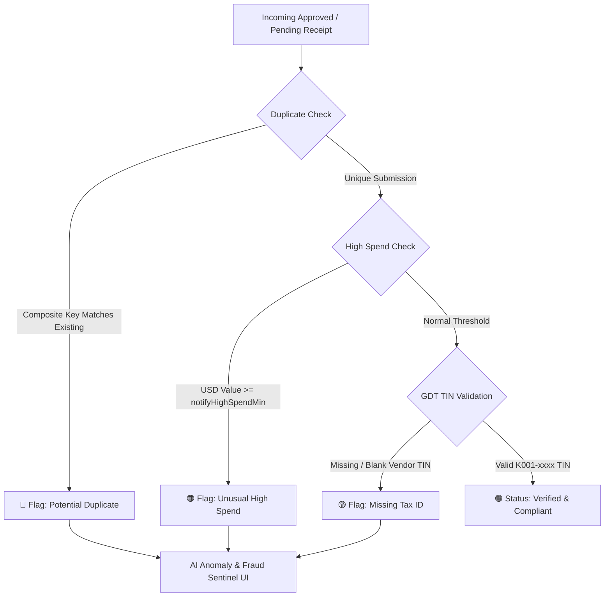
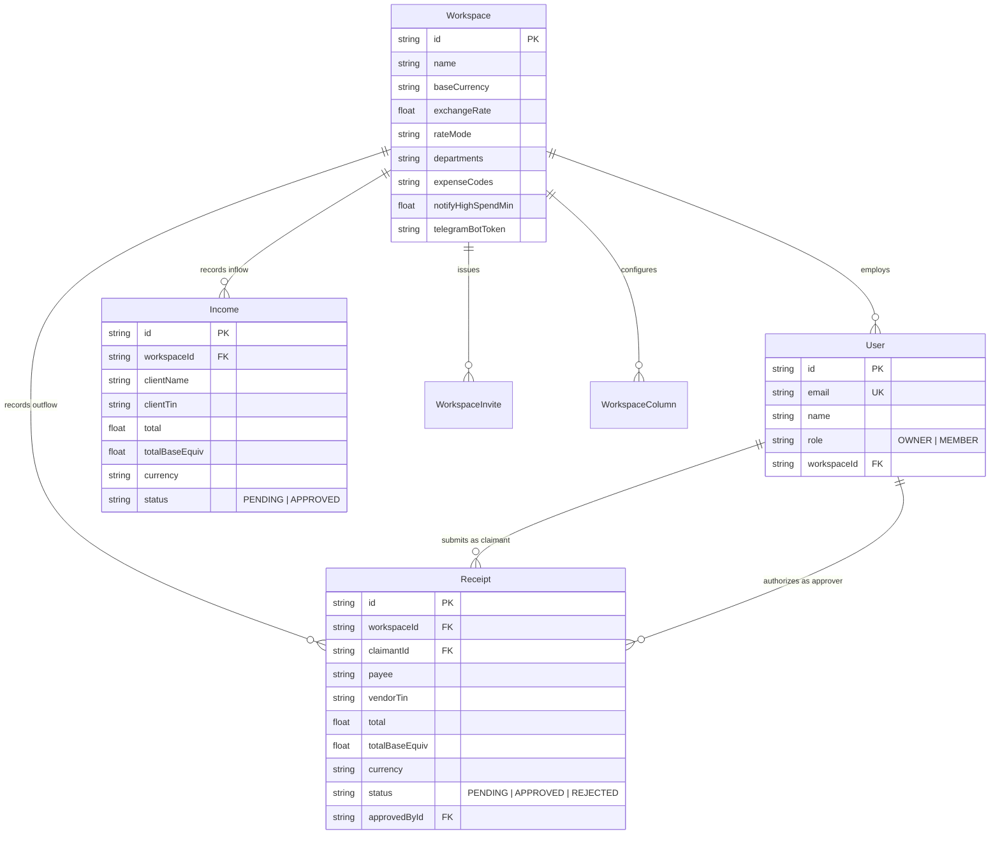

# Komnottra · Technical Documentation
**Version:** 1.0.0  
**Target Platform:** Production Web / Docker Enterprise  
**Primary Focus:** Architecture, Algorithmic Engine, Security & Multi-Tenancy Design  

---

## 1. Executive Summary & System Overview

**Komnottra** (កំណត់ត្រា - Khmer for *"Records / Notes"*) is an enterprise financial intelligence and accounting management platform engineered specifically for the Cambodian commercial ecosystem. 

Cambodian enterprises face unique accounting hurdles:
1. **Dual-Currency Reality**: Daily business operations freely mix US Dollars (`USD`) and Khmer Riel (`KHR`), requiring real-time currency conversion against the National Bank of Cambodia (NBC) market rate.
2. **Tax Compliance (GDT)**: Cambodian General Department of Taxation regulations require formal Taxpayer Identification Numbers (TIN) on invoices for Value-Added Tax (VAT) input deduction.
3. **Decentralized Receipt Intake**: Field staff submit paper receipts, ABA KHQR payment slips, taxi receipts (PassApp/Grab), and utility bills across web and Telegram messaging.

Komnottra resolves these challenges through an end-to-end automated pipeline: capturing receipts via camera, file upload, or Telegram; parsing them with multimodal Vision AI; normalizing ledger flows across currencies; detecting fraud and duplicates; and projecting operational cash runway.

```
+-----------------------------------------------------------------------------------+
|                                INGESTION LAYER                                    |
|   Web UI (Camera / Drag & Drop)   |   Telegram Bot Webhook   |   Manual Inflow    |
+-----------------------------------+--------------------------+--------------------+
                                      |
                                      v
+-----------------------------------------------------------------------------------+
|                         PROCESSING & EXTRACTION ENGINE                            |
|     Multimodal Gemini 2.5 Flash / OmniRoute AI Proxy  |  Date & Text Sanitizers   |
+-----------------------------------------------------------------------------------+
                                      |
                                      v
+-----------------------------------------------------------------------------------+
|                       DUAL-CURRENCY NORMALIZATION LAYER                           |
|       NBC Auto Rate (1 USD = 4,100 KHR)  |  Unified `totalBaseEquiv` Ledger       |
+-----------------------------------------------------------------------------------+
                                      |
                                      v
+-----------------------------------------------------------------------------------+
|                     SECURITY & WORKSPACE ISOLATION (RBAC)                         |
|   Owner Authority (Approvals, Policies)  |  Member (Photo Submit, Record Inflow)  |
+-----------------------------------------------------------------------------------+
                                      |
                                      v
+-----------------------------------------------------------------------------------+
|                           STORAGE & PERSISTENCE LAYER                             |
|          PostgreSQL 18 (Prisma ORM)  |  Secure Volume-Mounted Blob Storage        |
+-----------------------------------------------------------------------------------+
                                      |
                                      v
+-----------------------------------------------------------------------------------+
|                       ANALYTICS, COMPLIANCE & FORECASTING                         |
|   Cashflow Donut  |  Runway Horizon  |  GDT Tax Ring  |  Fraud & Anomaly Sentinel |
+-----------------------------------------------------------------------------------+
```

---

## 2. System Architecture & Topology

### 2.1 Technology Stack

| Layer | Technology | Rationale & Selection Criteria |
| :--- | :--- | :--- |
| **Frontend Framework** | **Next.js 16 (Turbopack, App Router)** | Server-rendered high performance, fast compilation, hybrid static/dynamic routing. |
| **UI & Styling** | **Vanilla CSS Modules** | Ultra-clean CSS architecture with zero framework bloat, CSS variables for design tokens. |
| **Backend & APIs** | **Next.js Route Handlers (Edge & Node runtime)** | Integrated type-safe endpoints with native streaming and multipart handling. |
| **ORM & Database** | **Prisma ORM + PostgreSQL 18 Alpine** | Strongly typed schema migrations, relation modeling, and relational data integrity. |
| **AI Vision Engine** | **Google Gemini 2.5 Flash + OmniRoute Proxy** | High-throughput multimodal OCR extraction supporting Khmer script and unstructured bills. |
| **Authentication** | **Stateless JWT (`jose`) + HTTP-Only Cookie** | Cross-site request forgery resistance, stateless multi-container scaling. |
| **Deployment & Orchestration** | **Docker Multi-Stage Build + Compose** | Multi-container isolation, deterministic builds, lightweight Alpine footprints. |
| **Network & Edge** | **Cloudflare Zero-Trust Tunnel** | Ingress protection, automatic SSL/TLS termination, zero open inbound host ports. |

---

### 2.2 Container Topology

The application environment runs across five isolated Docker services networked via an internal bridge (`komnottra-net`):



1. **`komnottra-web`** (Next.js Application):
   - Multi-stage Alpine container running standalone Next.js server output.
   - Serves UI components, server route handlers, and static assets.
   - Non-root user execution (`nextjs:nodejs`, UID 1001) for container hardening.
2. **`komnottra-db`** (PostgreSQL Database):
   - PostgreSQL 18 Alpine with persistent data directory volume (`./data-stuff/postgres`).
   - Enforces strict foreign keys, relational cascading, and indexed queries.
3. **`komnottra-omniroute`** (Local AI Proxy):
   - Intelligent fallback gateway proxying vision prompts to Google Gemini.
   - Manages API key failover, connection retries, and local prompt caching.
4. **`komnottra-tunnel`** (Cloudflare Tunnel):
   - Secure edge gateway exposing `komnottra-web` to the live domain without port-forwarding.
5. **`komnottra-studio`** (Internal Developer GUI):
   - Isolated web GUI for developer schema inspection on port 5555.

---

## 3. Core Algorithmic Engine

### 3.1 Multimodal OCR & Cambodian Invoice Parsing Heuristic
* **Implementation**: `src/lib/gemini.ts`, `src/app/api/scan/route.ts`



#### Step-by-Step Mechanism:
1. **Payload Ingestion & Buffer Sanitization**:
   - The route handler receives incoming buffers (either from multipart form uploads or JSON base64 payloads).
   - Validates MIME signatures (`image/jpeg`, `image/png`, `image/webp`, `application/pdf`).
   - Assigns a cryptographically collision-resistant filename (`receipt-${timestamp}-${random}.ext`) and writes the raw image to `/app/public/uploads/`.
2. **Khmer-Specialized Prompt Engineering**:
   - The multimodal model is injected with contextual knowledge of Cambodian business documentation:
     - **ABA KHQR Slips**: Transaction hashes, terminal IDs, and dual-currency text.
     - **PassApp / Grab Taxi Slips**: Fare structures, driver IDs, and trip date timestamps.
     - **Utility Invoices (EDC Electricity / PPWSA Water)**: Customer IDs, consumption periods, and official invoice series.
     - **Supermarket Slips (Lucky, Chip Mong, Aeon)**: Multi-line tax breakdowns with Khmer script headers (*អាករលើតម្លៃបន្ថែម* - VAT).
3. **Entity Extraction Schema**:
   The engine extracts:
   - `vendor`: Business counterparty name in Khmer or English.
   - `vendorTin`: Cambodian Tax Identification Number (`K001-xxxxxxxx` or `L...`).
   - `total`: Pure numeric total amount.
   - `amountExclVat`: Subtotal before tax if explicitly listed; otherwise defaults to total.
   - `vat`: Explicit VAT only if itemized on the bill; defaults to 0.
   - `currency`: Enforces strict selection between `KHR` and `USD`.
   - `category`: Maps to the company's approved expense codes (`6100 Office`, `6200 Meals`, etc.).
   - `confidence`: Confidence score (50–99%) based on optical readability.

---

### 3.2 Dual-Currency General Ledger Normalization
* **Implementation**: `src/app/api/receipts/route.ts`, `src/app/api/income/route.ts`

Cambodian accounting requires dual-sided reporting where an invoice can be billed in USD and paid in KHR, or vice versa. Komnottra solves this through **Unified Base Equivalence**:

$$\text{totalBaseEquiv} = \begin{cases} 
  \text{total} & \text{if } \text{Currency} = \text{BaseCurrency} \\
  \cfrac{\text{total}}{\text{Rate}} & \text{if } \text{BaseCurrency} = \text{USD} \land \text{Currency} = \text{KHR} \\
  \text{total} \times \text{Rate} & \text{if } \text{BaseCurrency} = \text{KHR} \land \text{Currency} = \text{USD}
\end{cases}$$

Where:
* $\text{Rate}$: The workspace exchange rate (e.g. $1\text{ USD} = 4,100\text{ KHR}$).
* $\text{RateMode}$: `NBC_AUTO` (synced to the National Bank of Cambodia) or `FIXED` (company internal policy).

#### Two-Sided Ledger Normalization:
* **Inflow (Revenue)**: Client retainers, service invoices, sales proceeds.
* **Outflow (Expenses)**: Vendor receipts, operational burn, reimbursable employee expenses.
* **Net Cashflow Calculation**:
  $$\text{Net Position} = \sum \text{totalBaseEquiv}_{\text{Inflow}} - \sum \text{totalBaseEquiv}_{\text{Outflow}}$$

---

### 3.3 Temporal Aggregation & Multi-Format Date Parser
* **Implementation**: `parseDateComponents()` in `src/app/api/analytics/route.ts`

Cambodian point-of-sale machines and manual clerks produce conflicting date formats. The temporal parser normalizes all inputs into unified analytical time-series buckets:

```
Raw Receipt Date Strings:
  "23/09/2026"  -->  DD/MM/YYYY
  "2026-09-23"  -->  YYYY-MM-DD
  "23-09-2026"  -->  DD-MM-YYYY
  "2026/09/23"  -->  YYYY/MM/DD
  "Damaged/None"-->  Fallback to Record `createdAt` Timestamp

                       |
                       v
         [ Regex Tokenization & Sanitization ]
                       |
                       v
Normalized Date Object:
  {
    day: 23,
    month: 9,
    year: 2026,
    monthKey: "09/2026",
    yearKey: "2026",
    fullDateStr: "23/09/2026"
  }
```

This normalization guarantees that time-series aggregations, chronological filtering (`THIS_MONTH`, `LAST_MONTH`, `THIS_YEAR`, `CUSTOM_MONTH`, `ALL`), and timeline comparisons work seamlessly.

---

### 3.4 Predictive Cash Runway & Burn Rate Forecasting Engine
* **Implementation**: `src/app/api/analytics/route.ts`

The platform continuously models the operational survival horizon of the enterprise:

#### 1. Average Monthly Burn Rate:
$$\text{Burn Rate} = \frac{\sum_{i=1}^{N} \text{Approved Outflow}_i}{\max\left(1, \; |\mathcal{M}_{\text{active}}|\right)}$$
*Where $|\mathcal{M}_{\text{active}}|$ represents the number of distinct calendar months with operational expenditure.*

#### 2. Weighted Predictive 30-Day Forecast:
To forecast the upcoming month's burn, recent spending habits are given higher weight than historical averages, combined with a 5% conservative planning cushion:
$$\text{Next Month Forecast} = \left(0.60 \times \text{Burn}_{\text{recent}} + 0.40 \times \text{Burn}_{\text{average}}\right) \times 1.05$$

#### 3. Runway Horizon:
$$\text{Runway (Months)} = \frac{\max\left(0, \; \text{Net Cash Balance}\right)}{\max\left(1, \; \text{Monthly Burn}\right)}$$

#### 4. Health Matrix Classification:
```
           Runway < 3 Months            Runway 3 - 6 Months            Runway 6+ Months
       [ 🔴 CRITICAL DEFICIT ]       [ 🟡 CAUTIONARY BUFFER ]       [ 🟢 OPTIMAL RUNWAY ]
       Immediate cost cutting        Active expenditure watch       Healthy operational
       or capital call required      and revenue acceleration       growth posture
```

---

### 3.5 AI Fraud & Anomaly Sentinel Algorithms
* **Implementation**: `src/app/api/analytics/route.ts`, `src/app/page.tsx`



#### 1. Composite Duplicate Hash Detection:
To prevent double reimbursement (e.g. two staff members claiming the same team dinner, or an employee resubmitting an ABA transfer slip):
$$\mathcal{K}_{\text{dupe}} = \text{Hash}\left(\text{trim}(\text{lower}(\text{Payee})) \;||\; \text{Date} \;||\; \text{Amount}\right)$$
If $\mathcal{K}_{\text{dupe}} \in \text{SeenSet}$, the record is flagged as `DUPLICATE` in the Sentinel deck with an alert detailing the identical historical occurrence.

#### 2. Dynamic Threshold Policy Spike Detection:
Identifies non-standard expenditures by checking transaction values against company policy:
$$\text{IsAnomaly} = \begin{cases} 
  \text{True} & \text{if } \text{totalBaseEquiv}_{\text{USD}} \ge \text{Workspace}.\text{notifyHighSpendMin} \\
  \text{False} & \text{otherwise}
\end{cases}$$
*(Default policy threshold: \$100.00 USD equivalent).*

#### 3. Cambodian GDT Tax Readiness Scoring:
$$\text{Compliance Score} = \left(\frac{N_{\text{receipts with valid TIN}}}{N_{\text{total receipts}}}\right) \times 100\%$$
* If $\text{Score} \ge 70\%$: Tagged as **Compliant** (expenses qualify for official General Department of Taxation VAT input deductions).
* If $\text{Score} < 70\%$: Tagged as **Audit Risk** (unregistered vendor receipts cannot deduct VAT and risk tax office disallowance).

---

## 4. Security Architecture & Access Control

### 4.1 Authentication & Session Management

```
User Login Request (Email/Password or Google OAuth 2.0)
                       |
                       v
[ Argon2 / Bcrypt Password Verification & User Lookup ]
                       |
                       v
[ Issue Stateless JWT Signed via HS256 (`jose`) ]
  Payload: { userId, email, role, workspaceId, iat, exp (30 days) }
                       |
                       v
[ Encapsulate into HTTP-Only Secure Cookie: `komnottra_session` ]
  - HttpOnly: true (Shields against Cross-Site Scripting / XSS extraction)
  - SameSite: "lax" (Guards against Cross-Site Request Forgery / CSRF)
  - Secure: true in production (Enforces SSL/TLS transmission)
```

---

### 4.2 Multi-Tenancy & Row-Level Data Isolation

Multi-tenancy is enforced through **Logical Relational Isolation**. Every transaction, category, invite, and column rule is strictly bound to a tenant foreign key:

```prisma
model Workspace {
  id        String    @id @default(uuid())
  name      String
  users     User[]
  receipts  Receipt[]
  incomes   Income[]
}

model Receipt {
  id           String    @id @default(uuid())
  workspaceId  String
  workspace    Workspace @relation(fields: [workspaceId], references: [id])
  claimantId   String
  claimant     User      @relation(fields: [claimantId], references: [id])
}
```

* Every SQL query generated by Prisma ORM mandates `where: { workspaceId: session.workspaceId }`.
* Cross-tenant data leakage is structurally impossible: a member of Workspace A cannot query, update, or infer transactions belonging to Workspace B.

---

### 4.3 Role-Based Access Control (RBAC) Matrix

The system defines two primary operational roles:

| Action / Capability | Workspace OWNER | Staff MEMBER | Security Enforcement Layer |
| :--- | :---: | :---: | :--- |
| **Scan & Upload Receipts** | ✅ | ✅ | Client UI + `POST /api/scan` |
| **Record Client Income / Inflow** | ✅ | ✅ | Client UI + `POST /api/income` |
| **View Home Dashboard & Stats** | ✅ | ✅ | Authenticated Session Query |
| **View Approvals Queue Status** | ✅ | ✅ | Read-only state for members |
| **Approve / Reject Receipts** | ✅ | ❌ | UI Guard + `PATCH /api/receipts` (403 Forbidden) |
| **Approve / Reject Client Income** | ✅ | ❌ | UI Guard + `PATCH /api/income` (403 Forbidden) |
| **Batch Approve Submissions** | ✅ | ❌ | UI Guard + Server Batch Handler |
| **Modify Exchange Rate Policies** | ✅ | ❌ | `PATCH /api/workspace` |
| **Configure Telegram Bot Tokens** | ✅ | ❌ | `POST /api/workspace` |
| **Invite & Remove Team Members** | ✅ | ❌ | `POST/DELETE /api/workspace/members` |
| **Export Official Excel Ledgers** | ✅ | ✅ | Authenticated Session Export |

---

### 4.4 Ingress & Infrastructure Hardening

1. **Non-Root Docker Sandboxing**:
   The production image creates a restricted system user (`nextjs`, UID 1001) with zero `sudo` privileges, preventing container escape vulnerabilities.
2. **Database Network Isolation**:
   Port `5432` is bound strictly to `127.0.0.1` and internal Docker network bridges. External internet traffic cannot reach PostgreSQL directly.
3. **Prepared Statements**:
   All database operations utilize Prisma's parameterized queries, providing complete immunity against SQL injection attacks.
4. **Cloudflare Zero-Trust Perimeter**:
   Cloudflare Tunnel creates an encrypted outbound-only tunnel to Cloudflare edge nodes. No firewall ports (80/443) are exposed to the public internet, eliminating port-scanning and DDoS exposure.

---

## 5. Entity Relationship Data Model



---

## 6. Summary Checklist for Production Readiness

* [x] **Dual-Currency Ledger**: Live conversion between USD and KHR with dynamic exchange rate configurations.
* [x] **GDT Tax Compliance**: Cambodian Taxpayer Identification Number tracking and automated input VAT eligibility scoring.
* [x] **AI OCR Vision Engine**: Multi-stage fallback processing with Gemini 2.5 Flash and local OmniRoute proxy.
* [x] **Fraud & Sentinel Protection**: Composite duplicate hash screening and high-value expenditure outlier detection.
* [x] **Multi-Tenancy & RBAC**: Strict workspace data isolation with Owner-only approval enforcement at the API and UI layers.
* [x] **Docker Standalone Architecture**: High-efficiency container packaging with Cloudflare Tunnel ingress protection.
