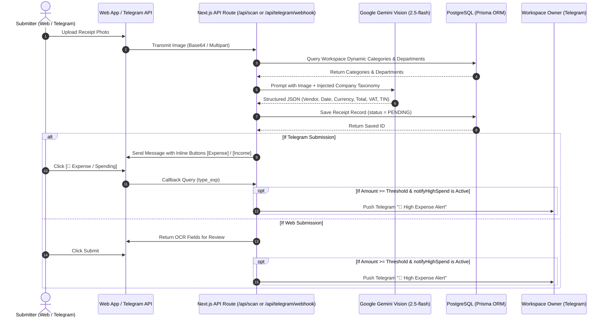
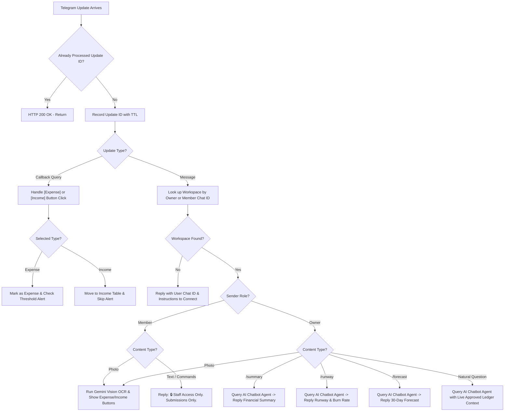
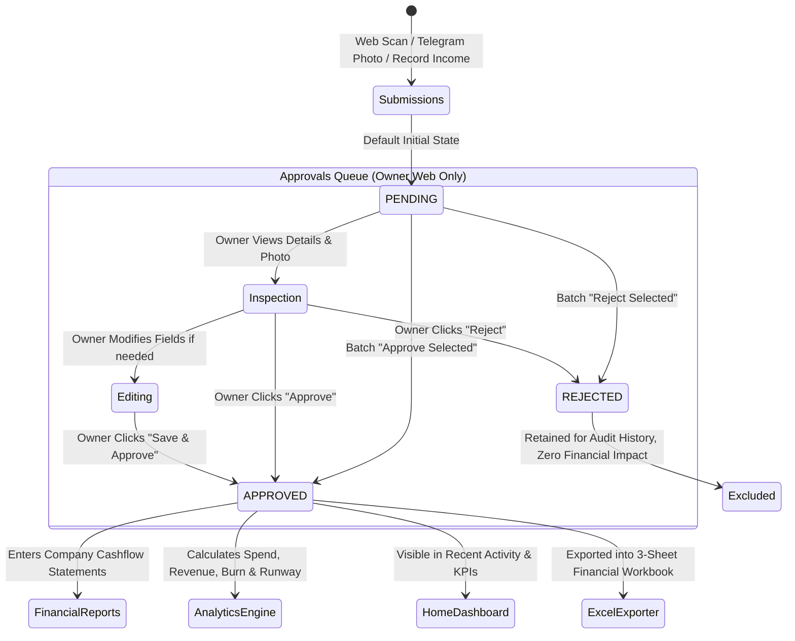

# Komnottra — Feature Flow Architecture

## 1. Vision OCR & Multi-Channel Receipt Processing Flow

Komnottra ingests receipts and billing slips through two distinct pathways: the **Web Application** and the **Telegram Webhook**. Both channels funnel into the Gemini Vision engine with dynamic prompt injection.



---

## 2. Telegram Bot 2-Tier RBAC & Dispatching Flow

Telegram interactions are routed through a single webhook endpoint (`/api/telegram/webhook`) and filtered using strict role separation based on registered chat IDs.



---

## 3. Mandatory Approvals & Ledger Gating Flow

The core integrity principle of Komnottra is that **unapproved data never pollutes financial analytics, reports, or home KPIs**.



---

## 4. Unified Company Cashflow & Multi-Sheet Excel Flow

```
[Reports Screen Request]
       │
       ▼
Fetch Approved Receipts (status = APPROVED or REIMBURSED)
Fetch Approved Incomes (status = APPROVED)
       │
       ▼
Normalize Currency & Sign
   ├── Incomes: Positive (+), Green Badge
   └── Expenses: Negative (-), Red Badge
       │
       ▼
Sort Unified Array Chronologically by Date (descending)
       │
       ▼
Render Interactive Table & Calculate Top Cards:
   ├── Total Inflow: SUM(Approved Incomes in Base Currency)
   ├── Total Outflow: SUM(Approved Expenses in Base Currency)
   └── Net Cashflow: Total Inflow - Total Outflow
       │
       ▼
[User Clicks "Export Excel"]
       │
       ▼
API Route: /api/export
   ├── Sheet 1: Cashflow Ledger (Chronological Combined Statements)
   ├── Sheet 2: Expense Outflow (Itemized Tax Receipts & TINs)
   └── Sheet 3: Income Inflow (Itemized Client Invoices & Methods)
       │
       ▼
Browser Downloads: komnottra_financial_report_<date>.xlsx
```
