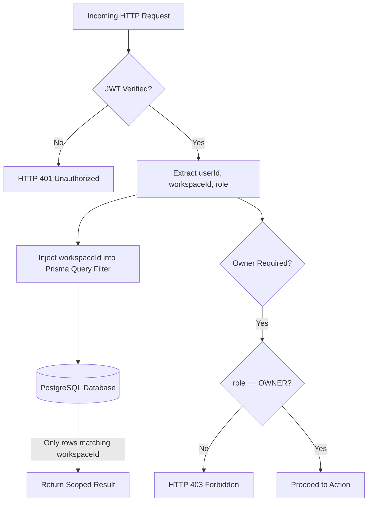
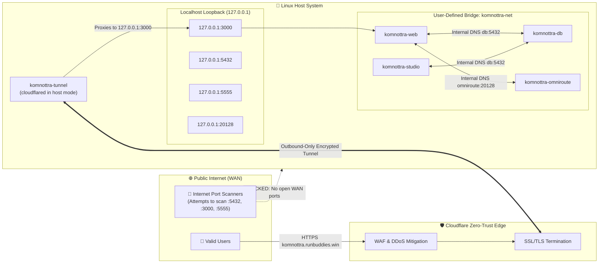

# Komnottra — Security Design, Multi-Tenancy Safeguards & Network Exposure

## 1. Multi-Tenant Workspace Safeguards & Isolation

Komnottra implements logical data segregation to ensure complete isolation between independent organizations. A user belonging to Workspace $A$ can never view, query, or mutate financial data belonging to Workspace $B$.



### A. Strict Database Scoping
Every data mutation and retrieval operation executes through Prisma with an explicit `workspaceId` condition extracted directly from the verified cryptographic session token, rather than client-supplied parameters:

```typescript
// Example: receipts route (/api/receipts)
const session = await getCurrentUser();
if (!session || !session.workspaceId) {
  return NextResponse.json({ success: false, error: 'Unauthorized' }, { status: 401 });
}

// All queries are strictly scoped to session.workspaceId
const receipts = await prisma.receipt.findMany({
  where: { workspaceId: session.workspaceId },
  orderBy: { createdAt: 'desc' },
});
```

### B. Role-Based Access Control (RBAC)
Two hierarchical roles are enforced:
1. **`OWNER` (Executive / Finance Lead):**
   - Can approve, batch-approve, or reject expense claims and client incomes.
   - Can modify workspace settings, exchange rates, and expense categories.
   - Can view company cashflow statements, monthly burn rate, and projected cash runway.
   - Authorized for two-way interactive AI Chatbot queries on Telegram.
2. **`MEMBER` (Staff / Submitter):**
   - Restricted to submitting expense receipts and client invoices.
   - Blocked from accessing the Approvals tab, Analytics tab, or workspace configuration.
   - Attempted access to owner-only endpoints triggers immediate `403 Forbidden` rejection.

---

## 2. Docker Network Architecture & Ingress Exposure Model

A critical aspect of the Komnottra security architecture is how Docker container networking, the host loopback interface (`127.0.0.1`), the default `docker0` bridge, and the public ingress gateway are designed.



### A. The `docker0` Bridge vs. User-Defined Bridge (`komnottra-net`)
- **Default `docker0` Bridge:** In Linux, the default Docker bridge `docker0` (commonly `172.17.0.1/16`) connects containers that do not specify a custom network. However, `docker0` lacks automatic container DNS resolution and isolates containers poorly.
- **Dedicated `komnottra-net` Bridge:** Komnottra defines an isolated bridge network (`komnottra-net`) in `docker-compose.yml`. Microservices communicate internally using service names (e.g., `postgresql://postgres:...@db:5432/komnottra`). Container IP addresses are internal to the Docker daemon and not routeable from external networks.

### B. Binding Exclusively to `127.0.0.1` (Zero Public Port Exposure)
In standard or insecure Docker configurations, developers often bind ports as `"3000:3000"` or `"5432:5432"`, which Docker routes by default to `0.0.0.0` (all network interfaces, including public WAN interfaces). This exposes databases and internal microservices directly to internet port scanners and automated credential brute-forcers.

**In Komnottra, every container port is explicitly bound to `127.0.0.1`:**
```yaml
services:
  db:
    ports:
      - "127.0.0.1:5432:5432" # Accessible ONLY from the host machine loopback

  web:
    ports:
      - "127.0.0.1:3000:3000" # Accessible ONLY from the host machine loopback

  studio:
    ports:
      - "127.0.0.1:5555:5555" # Database browser accessible ONLY from localhost

  omniroute:
    ports:
      - "127.0.0.1:20128:20128" # AI proxy accessible ONLY from localhost
```

### C. Zero-Inbound Cloudflare Tunnel Exposure Model
To expose the web application to the public internet without opening inbound ports:
1. **No Open Inbound Firewall Ports:** Ports 80, 443, 3000, 5432, and 5555 are **closed** on the external router and host firewall (`ufw` / `iptables`).
2. **Outbound Tunnel Connection:** The `komnottra-tunnel` container initiates an **outbound-only encrypted TLS connection** to the Cloudflare Edge network using a secure tunnel token (`CLOUDFLARE_TUNNEL_TOKEN`).
3. **Reverse Proxying:** When an external request hits `https://komnottra.runbuddies.win`, Cloudflare forwards the encrypted traffic through the active tunnel directly to `http://127.0.0.1:3000` on the host.
4. **Result:** The host server's real IP address is completely shielded from DNS queries, port scans, and DDoS floods.

---

## 3. Telegram Webhook RBAC & Information Barrier

Because Telegram interactions occur outside the browser's cookie context, authorization is enforced via the sender's Telegram `Chat ID`:

```
┌─────────────────────────────────────────────────────────────┐
│                   Incoming Telegram Chat ID                 │
└──────────────────────────────┬──────────────────────────────┘
                               │
            ┌──────────────────┴──────────────────┐
            ▼                                     ▼
   Found in telegramChatId?              Found in telegramMemberChatIds?
  (Owner Executive Chat ID)                 (Staff Member Chat ID)
            │                                     │
   ┌────────┴────────┐                   ┌────────┴────────┐
   │   FULL ACCESS   │                   │ RESTRICTED ONLY │
   │ • Photo Uploads │                   │ • Photo Uploads │
   │ • All Alerts    │                   │ • [Exp]/[Inc]   │
   │ • AI Chatbot    │                   │ • NO Chatbot Q&A│
   │ • /summary      │                   │ • NO Summaries  │
   │ • /runway       │                   │ • NO Alerts     │
   └─────────────────┘                   └─────────────────┘
```

1. **Information Barrier:** If a registered team member attempts to send `/summary`, `/runway`, or asks questions like *"How much cash do we have?"*, the bot immediately replies:
   > `Staff Access Only — You are authorized for receipt and invoice submissions only. Financial analytics and chatbot queries are reserved for Workspace Owners.`
2. **Alert Protection:** High-spend expense alerts are addressed exclusively to IDs listed under `telegramChatId` (owners). Staff members never receive expenditure alerts.

---

## 4. Session Security & Secret Management

- **Cookie Security:** The JWT session token is stored in an `HttpOnly` cookie, preventing client-side JavaScript from reading the token and mitigating Cross-Site Scripting (XSS) session theft.
- **Password Hashing:** User passwords are encrypted with `bcryptjs` using 10 salt rounds before storage in PostgreSQL. Plaintext passwords are never logged or stored.
- **Environment Isolation:** All secret keys (`JWT_SECRET`, `NEXTAUTH_SECRET`, `POSTGRES_PASSWORD`, `GEMINI_API_KEY`) are loaded via container environment variables, separated from source control.
