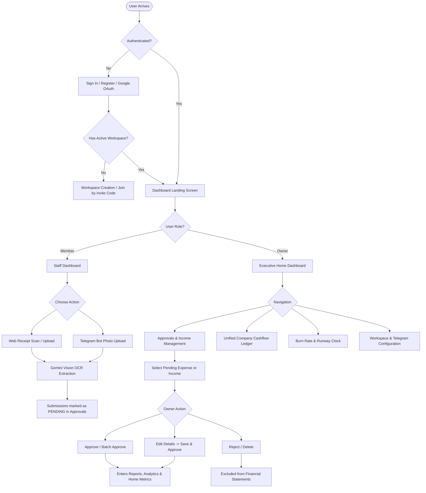

# Komnottra — End-to-End User Flow Specification

## 1. Executive Summary & Persona Definitions

Komnottra operates on a multi-tenant, role-governed paradigm tailored for Cambodian business operations, accounting compliance, and dual-currency management (USD / KHR). Two primary personas interact with the system:

1. **Workspace Owner (Executive / Admin / Finance Lead):**
   - Full authority over company financial configuration, exchange rates, and budgets.
   - Authority to approve, reject, or edit pending expense claims and client income records.
   - Access to confidential business intelligence: burn rate, projected runway, cashflow statements, and audit ledgers.
   - Interactive conversational bot access in Telegram with real-time push alerts for high-value expenditures.

2. **Team Member (Staff / Field Employee):**
   - Restricted operational scope: receipt scanning and invoice submission.
   - Can upload receipts via web dashboard or snap photos on Telegram.
   - Can classify uploads as **Expense / Spending** or **Income / Inflow**.
   - Zero access to company-wide financial totals, runway forecasts, or owner approval queues.

---

## 2. Global User Flow Diagram



---

## 3. Detailed Step-by-Step Journeys

### Journey A: First-Time Onboarding & Setup

```
[Arrival] 
   └── Land on https://komnottra.runbuddies.win
         ├── Choose Email/Password registration or Google OAuth
         └── If first user:
               ├── Setup Workspace: Name, Base Currency (USD or KHR), Initial NBC Exchange Rate (4,100 KHR)
               ├── Define Initial Expense Categories & Departments
               └── System generates unique Workspace Invite Code (e.g., KOM-3058)
```

1. **Authentication:** The user registers via credentials or Google Sign-In. A session JWT cookie (`komnottra-token`) is securely issued (`HttpOnly`, `SameSite=Lax`).
2. **Workspace Association:** If no workspace exists, the user is guided through the creation modal. The creating user becomes the workspace `OWNER`.
3. **Staff Invites:** The owner shares the Workspace Invite Code or email invitations with staff members. Staff members who register with the code are assigned the `MEMBER` role.

---

### Journey B: Staff Member Expense Submission (Web & Telegram)

#### Path 1: Web Dashboard Submission
1. Member logs in and clicks **Scan Receipt** (`/scan`).
2. Member selects image file or opens device camera.
3. System runs client-side preview and transmits base64 image payload to `/api/scan`.
4. Gemini Vision OCR identifies vendor, total amount, currency, tax TIN, date, category, and department.
5. Member reviews extracted preview, selects payment method, and clicks **Submit for Approval**.
6. The receipt is committed to PostgreSQL with `status: "PENDING"`.
7. If the expenditure exceeds the workspace alert threshold (e.g. > $100 USD), an automated push alert is dispatched to the Owner's Telegram.

#### Path 2: Telegram Bot Mobile Snap
1. Member opens the company Telegram bot.
2. Member sends a photo of a restaurant receipt, transport ticket, or client payment slip.
3. Bot automatically confirms receipt: `⏳ Scanning receipt with Gemini Vision...`
4. Image is parsed and saved as `status: "PENDING"`.
5. Bot replies with parsed breakdown and two inline buttons:
   - `[ 🔴 Expense / Spending ]`
   - `[ 🟢 Income / Inflow ]`
6. Member taps **`🔴 Expense / Spending`**:
   - The bot confirms: `⏳ Confirmed as Company Expense (Pending Review)!`
   - If the receipt meets/exceeds the threshold, an alert is dispatched to the Owner.
7. Member taps **`🟢 Income / Inflow`**:
   - The record converts to an Income entry with `status: "PENDING"`.
   - The bot confirms: `💵 Recorded as Company Inflow (Pending Review)!`
   - **No alert is sent** (inflow does not alert).

---

### Journey C: Owner Review & Approval Workflow

```
[Owner Navigates to Approvals Tab]
   ├── Filter Subtabs: [All Pending] | [Expenses / Receipts] | [Client Incomes]
   ├── Action 1: Batch Approval
   │     ├── Checkbox select multiple rows
   │     └── Click "Approve Selected" -> All marked APPROVED simultaneously
   ├── Action 2: Inspect & Edit
   │     ├── Click row to view Side Inspector (photo, merchant, TIN, submitter)
   │     ├── Click "Edit Record"
   │     ├── Modify incorrect values (e.g. fix OCR misread amount or category)
   │     └── Click "Save & Approve" -> Updates database & marks APPROVED
   └── Action 3: Manual Inflow Entry
         ├── Click "+ Record Income / Bill"
         ├── Enter Client name, Invoice #, Amount, Currency, Payment Method
         └── Record saved as PENDING in approval ledger
```

---

### Journey D: Reporting & Reconciliation

1. **Viewing Statements:** Owner navigates to **Reports**.
2. **Unified Ledger View:** All approved expenses (red outflows `-`) and approved client incomes (green inflows `+`) appear in a unified, chronologically sorted financial statement.
3. **Live Totals:**
   - Total Inflow (Approved)
   - Total Outflow (Approved)
   - Net Cashflow Balance
   - Verified Records Count
4. **Excel Export:** Owner clicks **Export Excel**. The browser downloads a 3-sheet `.xlsx` file containing the consolidated Cashflow Ledger, Outflow Expenses, and Inflow Revenues.
